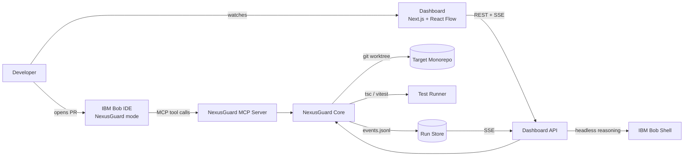

# NexusGuard

> **Blast-radius analysis and bounded self-healing for TypeScript monorepos, powered by IBM Bob.**
> Built for the Lablab.ai × IBM Bob 2.0 Hackathon (Sept 25–27, 2026).

---

## The Problem

A one-line "perf" change in `shared-pricing` returns **cents instead of dollars**. TypeScript passes. CI is green on that package. But `billing-service` now charges 100× too much. `notification-service` renders wrong totals. `checkout-service` is fine — it never calls the changed function.

**How do you know which?** You don't, unless you trace every consumer. NexusGuard does that automatically.

---

## What NexusGuard Does

```
base..head diff ──▶ deterministic graph ──▶ IBM Bob semantic verdict ──▶ oracle confirmation ──▶ test-gated self-heal ──▶ PR
```

1. **Deterministic blast radius** — `ts-morph` builds an exact symbol reference graph. No LLM guessing who imports what.
2. **Grounded semantic verdicts** — IBM Bob judges *meaning* (`BROKEN | AT_RISK | SAFE | UNCERTAIN`). Every claim must cite an exact verbatim quote from the evidence we gave it. The validator (V1–V10) blocks any hallucinated ID, line, or quote.
3. **Oracle confirmation** — `tsc` and `vitest` confirm findings. A confirmed finding outranks an opinion.
4. **Bounded self-healing** — Patch only the broken consumer files. At most 3 attempts. `tsc` + tests must pass. Never auto-merge.
5. **Visible Bob usage** — IBM Bob IDE drives the whole flow through purpose-built MCP tools and a custom mode. The dashboard mirrors state changes live.

---

## Architecture



### Pipeline Stages

| Stage | Name | LLM? | Budget |
|---|---|---|---|
| S1 | DiffIngestor | No | 300ms |
| S2 | WorkspaceGraphBuilder | No | 5s cold |
| S3 | ChangeClassifier | No | 500ms |
| S4 | CandidateExpander | No | 1s |
| S5 | CompilerOracle | No | 15s |
| S6 | EvidenceBundler | No | 200ms |
| **S7** | **SemanticReasoner (IBM Bob)** | **Yes** | **60s** |
| S8 | Validator + Grounding Checker | No | 50ms |
| S9 | TestOracle | No | 30s |
| S10 | Scorer + ReportBuilder | No | 50ms |
| **S11** | **Remediator (IBM Bob)** | **Yes** | **90s/attempt** |
| S12 | Reverifier | No | 30s |

---

## Hallucination Control

| Layer | What it prevents |
|---|---|
| L1 Deterministic discovery | Made-up files, dependencies |
| L2 Trusted change facts | Misreading what changed |
| L4 Closed-world output | Invented IDs or labels |
| L5 Quote verification | Fabricated code claims |
| L8 Oracle precedence | LLM overriding compiler/tests |
| L11 Exact-match edits | Patches applied to imagined code |
| L12 Test gate | "Looks right" patches |
| L13 Human in the loop | Anything residual — never auto-merge |

**Surviving hallucinations in `report.json`: 0 by construction** (asserted in unit tests).

---

## Demo Scenario (S01)

**Base (`main`):** `calculateFee(100)` → `3.2` (dollars)
**PR #104:** `calculateFee(100)` → `320` (cents, same signature — tsc passes)

| Service | Result | Why |
|---|---|---|
| `billing-service` | 🔴 BROKEN | `total = subtotal + fee` → 100 + 320 = 420 |
| `notification-service` | 🟡 AT_RISK | reads `total` over HTTP |
| `checkout-service` | 🟢 SAFE (import-only) | imports package but never calls `calculateFee` |

**Heal:** `const fee = calculateFee(subtotal) / 100;` — billing test passes, notification resolves transitively.

---

## Eval Results (fill in after running)

| Metric | Target | Result |
|---|---|---|
| Candidate recall | 100% | TBD |
| Finding precision | ≥ 85% | TBD |
| Finding recall | ≥ 80% | TBD |
| Negative-control FP | 0 BROKEN | TBD |
| Grounding pass rate (1st try) | ≥ 90% | TBD |
| Surviving hallucinations | 0 | 0 ✓ |
| Scope violations applied | 0 | 0 ✓ |
| Heal success@3 | ≥ 70% | TBD |

---

## Guardrails

**ScopeGate:** BROKEN consumer files only. Producer files, tests, configs, package.json, lockfiles — all forbidden.

**DenyList:** `@ts-ignore`, `@ts-expect-error`, `as any`, `eslint-disable`, `.skip`, `.only`, `eval`, `process.exit` — all blocked.

**Loop bounds:** 3 attempts max, 90s per attempt, 30 changed lines max, 5 files max.

**Post-hoc audit (`verify_patch`):** `git diff` checked against the allowlist even if Bob edits directly in the IDE.

---

## Repository Layout

```
bob2.0/
├── packages/
│   ├── core/              # All pipeline logic (S1-S12), ports, adapters
│   ├── cli/               # nexusguard analyze | remediate | eval | replay
│   ├── mcp-server/        # 7 MCP tools for Bob IDE
│   └── dashboard/         # Next.js + React Flow visualization
├── sample-platform/       # Demo repo: shared-pricing + billing + checkout + notification
├── evals/
│   ├── scenarios/         # S01, N04, X01, ...
│   └── results/
├── bob/
│   ├── nexusguard-mode.md # Custom mode rules text
│   └── mcp-config.json    # MCP server registration
├── docs/
│   ├── hour0-findings.md
│   └── prompt-changelog.md
├── .env.example           # All environment variables, no values
└── render.yaml            # Render Blueprint for the dashboard
```

---

## Quick Start

**Requirements:** Node.js ≥ 22.12, git. IBM Bob Shell / Bob IDE for live reasoning.

```bash
# Install dependencies
npm ci

# Build core + CLI
npm run build -w packages/core
npm run build -w packages/cli

# Run the MCP server (for Bob IDE)
node packages/mcp-server/dist/index.js

# Run the dashboard (http://localhost:3001)
cp .env.example packages/dashboard/.env.local   # then fill in BOB_API_KEY
npm run dev -w packages/dashboard

# Analyze a diff
npx nexusguard analyze --base <base-sha> --head <head-sha> --repo ./sample-platform

# Run unit tests (no LLM required)
npm run test -w packages/core
```

---

## Configuration

All settings are environment variables; see [`.env.example`](.env.example). Nothing secret lives in the repo.

| Variable | Used by | Purpose |
|---|---|---|
| `BOB_API_KEY` | core (Bob Shell provider) | API key for headless IBM Bob Shell calls |
| `BOB_BIN` | core | Bob Shell binary (default `bob`) |
| `NEXUSGUARD_REPO_ROOT` | dashboard | Repo whose `.nexusguard/` run store the dashboard reads |
| `NEXUSGUARD_ENABLE_ANALYZE` | dashboard | `true` to allow `POST /api/analyze`. Default: on in dev, **off in production** |
| `NEXUSGUARD_ALLOWED_REPOS` | dashboard | Production allowlist (comma-separated absolute paths) for analysis |

---

## Deploying the Dashboard (Render)

The dashboard is a long-running Next.js server that spawns `git`, `tsc`, `vitest` and Bob Shell, streams SSE and writes a run store to disk. That fits a Node web service (Render, Railway, Fly.io) better than serverless platforms.

1. Push this repo to GitHub.
2. In Render: **New → Blueprint**, select the repo. It picks up [`render.yaml`](render.yaml).
3. Set `BOB_API_KEY` in the Render dashboard if you enable analysis (the blueprint marks it `sync: false`, so it is never stored in git).

By default the public deployment serves the UI with **live analysis locked** (`NEXUSGUARD_ENABLE_ANALYZE=false`), so visitors cannot make your server run commands or spend your Bob credits. To run real analyses on a hosted instance you also need Bob Shell installed in the image, a git checkout of the target repo on the instance, and `NEXUSGUARD_ALLOWED_REPOS` pointing at it. For the hackathon demo, run live analysis locally or in Bob IDE (Mode A).

Free-tier Render services sleep after inactivity; the first request after a sleep takes about a minute.

---

## Security

- **No secrets in git.** Keys come from the environment only; `.env*`, key files and `.npmrc` are gitignored.
- **Run artifacts stay local.** `.nexusguard/` (prompts, raw LLM output, code snippets) is gitignored.
- **Locked-down API in production.** Analysis is opt-in, restricted to an allowlist of repos, limited to one run at a time, and errors never echo stack traces or paths.
- **Input validation.** Git refs are pattern-checked; run IDs are validated before they touch the filesystem (no path traversal).
- **Security headers.** `nosniff`, `X-Frame-Options: DENY`, strict referrer policy; `X-Powered-By` removed; image optimizer disabled.
- **Dependencies.** `npm audit` reports 0 known vulnerabilities (Next.js 15.5, React 19, Vitest 5).
- **Code under analysis is data.** Bob prompts treat evidence as untrusted; edits pass ScopeGate and DenyList before they touch disk.

Found a vulnerability? Please open a private security advisory on GitHub rather than a public issue.

---

## IBM Bob Integration

**Mode A (primary — live demo):** Bob IDE in NexusGuard mode calls the 7 MCP tools. Bob drives the analysis, every tool call is visible in Bob's panel. The dashboard mirrors state via SSE.

**Mode B (headless — CI/evals):** NexusGuard orchestrator calls Bob Shell non-interactively. Same core, same prompts, same validators.

**Custom mode rules:** `bob/nexusguard-mode.md` — specifies the procedure and hard rules (no ts-ignore, fix consumers not producers, etc.)

**MCP config:** `bob/mcp-config.json` — copy to Bob's MCP configuration directory.

---

## Limitations and Part 2 Roadmap

**Part 1 limitations:**
- TypeScript/JavaScript only
- Single git repository
- No GitHub App or webhooks
- No container sandboxing (process-level restrictions only)
- No automatic merging (by design — never)

**Part 2 (deferred):**
- Python, Go language support
- Polyrepo / cross-repo edges
- GitHub App + PR webhooks
- Container-sandboxed test execution
- Incremental graph indexing
- Producer-side compatibility suggestions
- PDF audit trail

---

## License

[MIT](LICENSE)

---

*Generated by NexusGuard + IBM Bob — review required.*
